# 🏛️ Nexora Architecture & System Blueprint

This document provides an exhaustive, principal-level architectural specification of the **Nexora E-Commerce Platform**. It details the structural philosophy, architectural patterns, state machines, component interactions, and distributed data flows governing the entire system.

---

## 📑 Table of Contents

- [1. Architectural Vision & Core Principles](#1-architectural-vision--core-principles)
- [2. C4 Architecture Models](#2-c4-architecture-models)
  - [2.1 Level 1: System Context Diagram](#21-level-1-system-context-diagram)
  - [2.2 Level 2: Container Diagram](#22-level-2-container-diagram)
  - [2.3 Level 3: Component Diagram (Backend API)](#23-level-3-component-diagram-backend-api)
- [3. Frontend Architecture & Flow](#3-frontend-architecture--flow)
  - [3.1 React 19 State Topology & Context Providers](#31-react-19-state-topology--context-providers)
  - [3.2 Route Guards & Navigation Flow](#32-route-guards--navigation-flow)
  - [3.3 Stripe Elements Integration Flow](#33-stripe-elements-integration-flow)
- [4. Backend Architecture & Flow](#4-backend-architecture--flow)
  - [4.1 Express 5 Pipeline & Middleware Chain](#41-express-5-pipeline--middleware-chain)
  - [4.2 Layered Architecture: Routes, Controllers & Services](#42-layered-architecture-routes-controllers--services)
- [5. Authentication & RBAC Architecture](#5-authentication--rbac-architecture)
  - [5.1 Cookie-Based Stateless JWT Mechanics](#51-cookie-based-stateless-jwt-mechanics)
  - [5.2 Dual-Tier Role Authorization (Customer vs. Admin)](#52-dual-tier-role-authorization-customer-vs-admin)
- [6. Polyglot Persistence Architecture](#6-polyglot-persistence-architecture)
  - [6.1 Relational vs. Document Database Rationale](#61-relational-vs-document-database-rationale)
  - [6.2 Cross-Database Identity Mapping](#62-cross-database-identity-mapping)
- [7. Distributed State Machines & Lifecycles](#7-distributed-state-machines--lifecycles)
  - [7.1 Order Lifecycle State Machine](#71-order-lifecycle-state-machine)
  - [7.2 Payment Lifecycle State Machine](#72-payment-lifecycle-state-machine)
  - [7.3 Inventory Reservation & Release Flow](#73-inventory-reservation--release-flow)
- [8. Design Patterns & Engineering Highlights](#8-design-patterns--engineering-highlights)

---

## 1. Architectural Vision & Core Principles

Nexora is designed to reflect an enterprise production architecture where different data domains exhibit fundamentally different scalability and consistency requirements:

1. **Polyglot Persistence by Domain Boundaries**:
   - **Identity & Accounts (MySQL)**: Requires strict relational schema consistency, relational integrity, foreign key readiness for future enterprise accounting, and fast primary-key lookups.
   - **Catalogs, Carts, & Orders (MongoDB)**: Requires document flexibility (polymorphic product attributes), fast nested sub-document queries (order items snapshotting), high-throughput JSON storage, and horizontal replica set scaling.
2. **ACID Transactions on Document Workflows**:
   - Despite using a NoSQL primary store for commerce entities, all critical mutative workflows (Order creation, stock deduction, and cart cleanup) are bundled inside MongoDB multi-document ACID transactions using Sessions.
3. **Idempotency as a First-Class Citizen**:
   - Network partitions, user double-clicks, and webhook retries must never result in duplicate orders, double payments, or corrupted inventory counts. Idempotency is enforced through compound database indexes and dedicated event deduplication tables.
4. **Decoupled Stateless Services**:
   - The application server maintains zero in-memory user session state. Authentication is verified via cryptographically signed JWT cookies, allowing the Express backend to scale horizontally behind a load balancer with zero sticky session affinity requirements.

---

## 2. C4 Architecture Models

### 2.1 Level 1: System Context Diagram

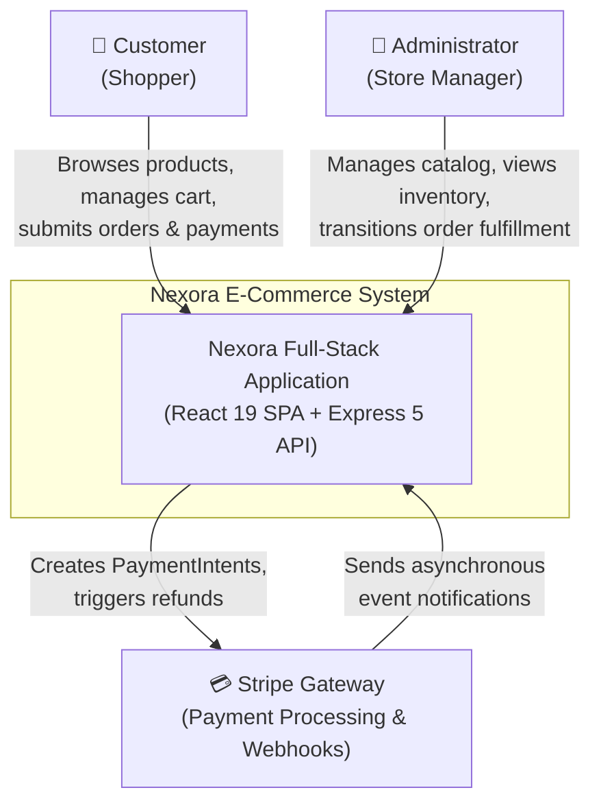

---

### 2.2 Level 2: Container Diagram

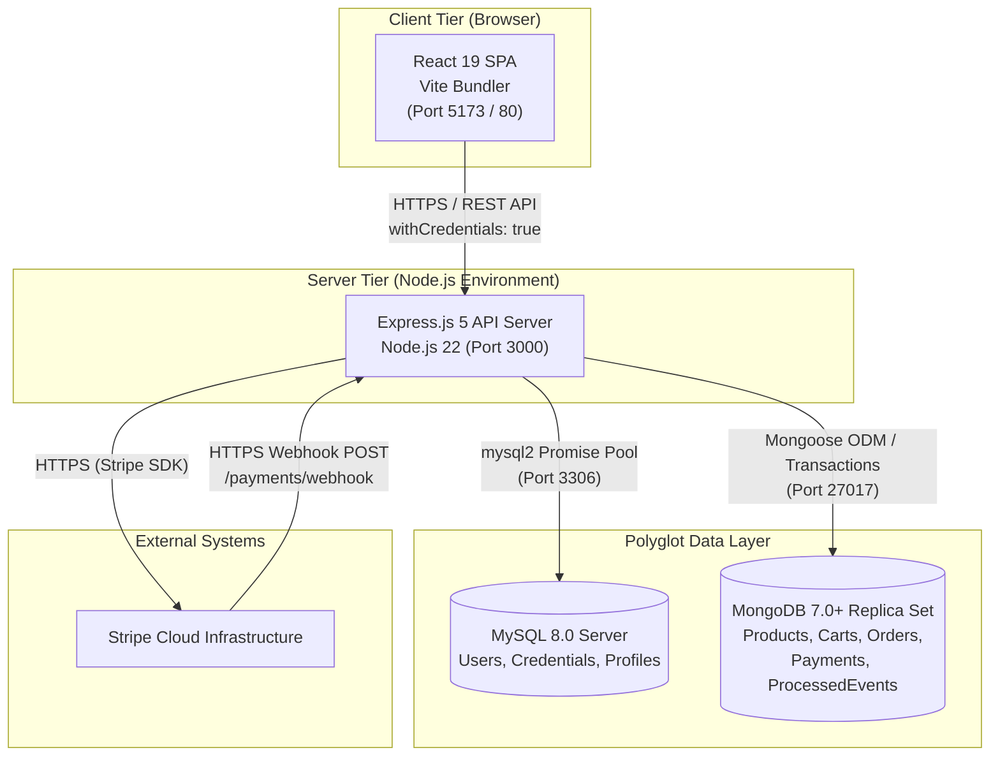

---

### 2.3 Level 3: Component Diagram (Backend API)

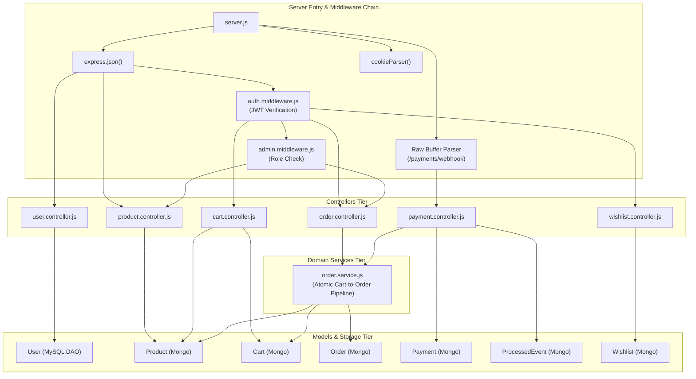

---

## 3. Frontend Architecture & Flow

### 3.1 React 19 State Topology & Context Providers

The client-side architecture leverages React 19 with a contextual state tree, avoiding heavy third-party state managers like Redux in favor of decoupled, specialized context providers:

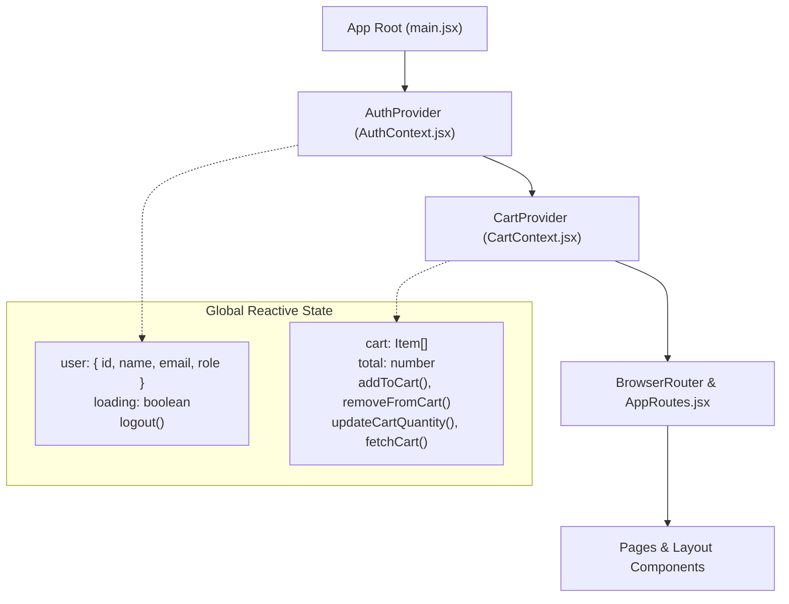

- **`AuthContext`**: On application mount, it automatically issues a background request to `GET /users/profile` to check the validity of the HTTP-Only cookie. If valid, the user's non-sensitive identity is stored in reactive state.
- **`CartContext`**: Synchronizes line items directly with the server via `GET /cart`. Uses `useCallback` to memoize fetch operations and provide stable references across component renders, avoiding cascading re-renders.

---

### 3.2 Route Guards & Navigation Flow

Client routes are classified into Public, Customer Protected, and Administrative:

```mermaid
flowchart TD
    Req[Customer requests URL] --> IsAuthPath{Is Path Protected?}

    IsAuthPath -- No --> RenderPublic[Render Public Component<br/>Home, Products, ProductDetails, Login, Register]
    IsAuthPath -- Yes --> CheckAuth{Is User Authenticated?}

    CheckAuth -- No --> RedirectLogin[Redirect to /login<br/>via Navigate component]
    CheckAuth -- Yes --> IsAdminPath{Is Route an Admin Route?}

    IsAdminPath -- No --> RenderProtected[Render Customer View<br/>Profile, Cart, Checkout, Orders, Wishlist]
    IsAdminPath -- Yes --> ClientGate[Client Allows Component Load<br/>(Backend RBAC guards all API calls)]
```

> [!NOTE]
> Client-side route guards provide optimal UX by redirecting unauthenticated users immediately. However, security is enforced strictly at the API layer where every administrative endpoint evaluates `admin.middleware.js`.

---

### 3.3 Stripe Elements Integration Flow

Nexora integrates Stripe via `@stripe/react-stripe-js` and `@stripe/stripe-js`, utilizing the modern **Payment Element** architecture:

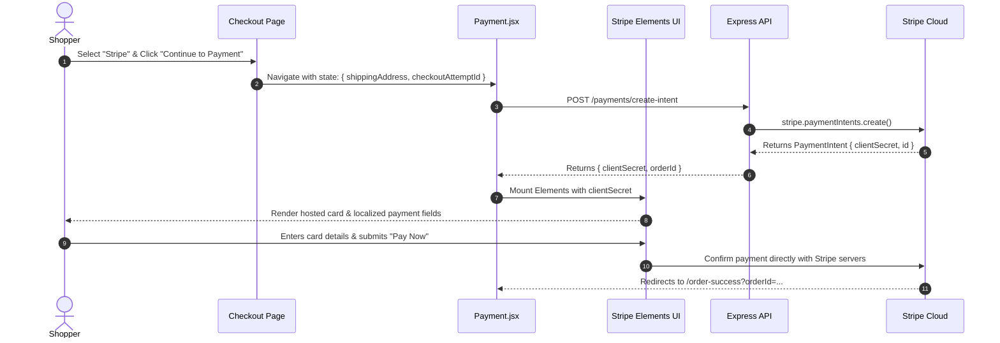

---

## 4. Backend Architecture & Flow

### 4.1 Express 5 Pipeline & Middleware Chain

The Express 5 request lifecycle follows an explicit ordering pattern to properly handle binary Stripe signatures before general JSON deserialization:

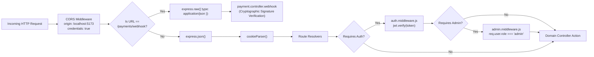

---

### 4.2 Layered Architecture: Routes, Controllers & Services

Nexora utilizes a **Layered Architecture (N-Tier)** pattern:

```
┌─────────────────────────────────────────────────────────────┐
│                       HTTP ROUTE TIER                       │
│  - Maps URLs & HTTP verbs to middleware & controller actions │
│  - Examples: /product, /cart, /order, /payments             │
└──────────────────────────────┬──────────────────────────────┘
                               │
                               ▼
┌─────────────────────────────────────────────────────────────┐
│                      CONTROLLER TIER                        │
│  - Extracts HTTP params, queries, body payloads             │
│  - Performs schema validation & boundary sanity checks      │
│  - Maps application errors to HTTP status codes (400, 404)  │
└──────────────────────────────┬──────────────────────────────┘
                               │
                               ▼
┌─────────────────────────────────────────────────────────────┐
│                    DOMAIN SERVICE TIER                      │
│  - Encapsulates pure business logic                         │
│  - Manages database sessions, locks, and transactions       │
│  - Example: createOrderFromCart() inside order.service.js   │
└──────────────────────────────┬──────────────────────────────┘
                               │
                               ▼
┌─────────────────────────────────────────────────────────────┐
│                 DATA ACCESS TIER (MODELS)                   │
│  - Mongoose ODM Models for MongoDB Document Collections     │
│  - Parameterized DAO Object for MySQL Users Table           │
└─────────────────────────────────────────────────────────────┘
```

---

## 5. Authentication & RBAC Architecture

### 5.1 Cookie-Based Stateless JWT Mechanics

Nexora employs an HTTP-Only Cookie strategy rather than `Authorization: Bearer <token>` headers stored in `localStorage`:

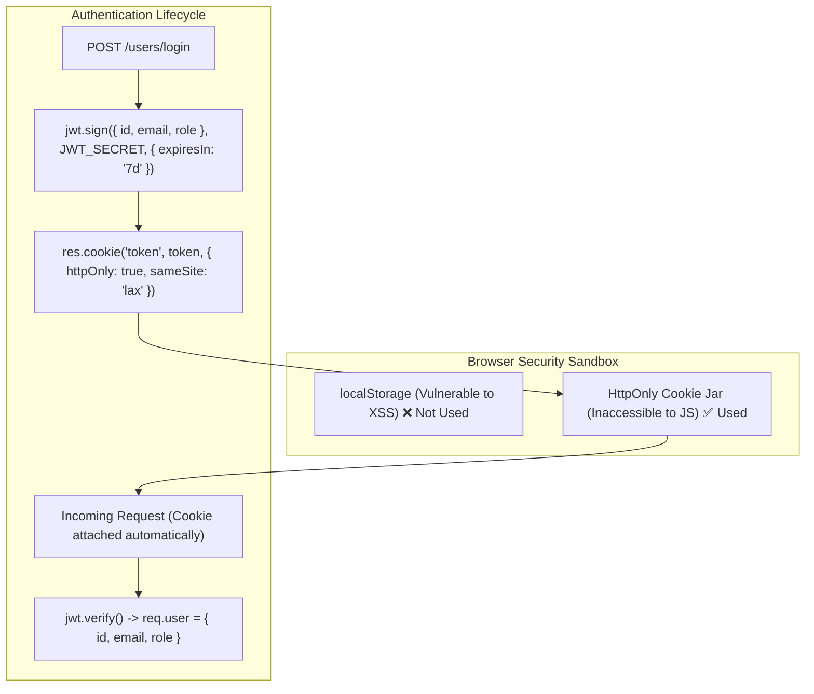

### Security Benefits:
- **XSS Immunity**: Even if an attacker injects malicious JavaScript into the DOM, they cannot read `document.cookie` because the `httpOnly` flag prevents script access.
- **CSRF Defense**: `sameSite: "lax"` ensures cookies are not sent on cross-site sub-requests (such as malicious image tags or cross-origin POST forms).

---

### 5.2 Dual-Tier Role Authorization (Customer vs. Admin)

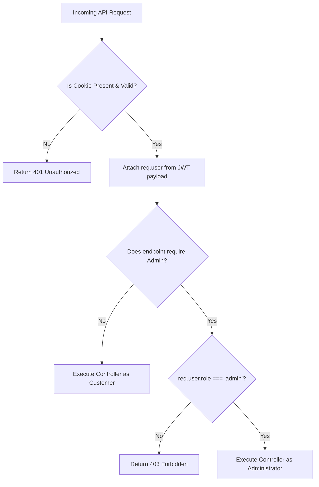

---

## 6. Polyglot Persistence Architecture

### 6.1 Relational vs. Document Database Rationale

| Dimension | MySQL 8.0 (Relational Store) | MongoDB 7.0+ (Document Store) |
| :--- | :--- | :--- |
| **Domain** | User Accounts, Credentials, Profiles | Products, Carts, Orders, Payments, Webhook Events |
| **Access Pattern** | Low-frequency writes, high-integrity reads | High-frequency catalog reads, complex nested writes |
| **Schema Strictness** | Rigid relational schema with column definitions | Dynamic document schemas with Mongoose type validation |
| **Transaction Scope** | ACID row-level locking | Multi-document ACID transactions via replica sets |
| **Rationale** | Identity demands absolute uniqueness, stable foreign keys, and relational integrity. | Order items represent point-in-time snapshots of dynamic product attributes that should never change retroactively. |

---

### 6.2 Cross-Database Identity Mapping

Nexora links the two independent database engines via the **Numeric User ID** abstraction:

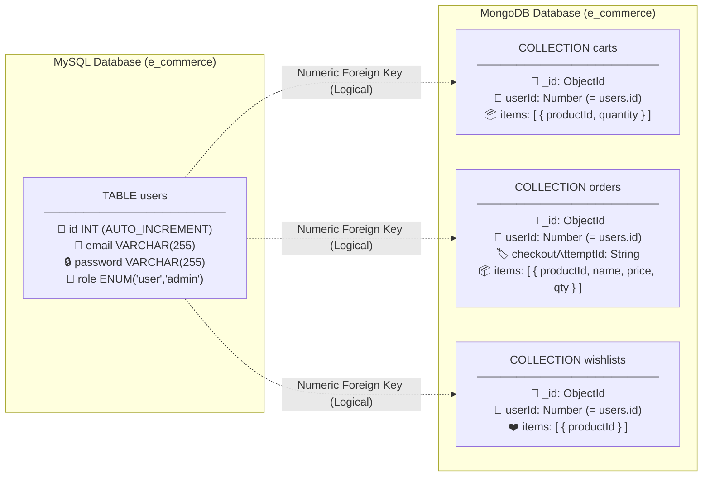

---

## 7. Distributed State Machines & Lifecycles

### 7.1 Order Lifecycle State Machine

The order lifecycle adheres to a deterministic finite state machine, enforced in `order.controller.js`:

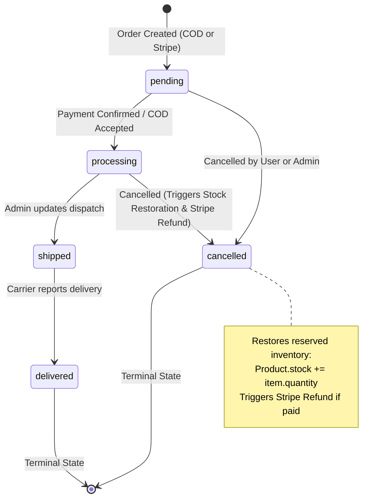

---

### 7.2 Payment Lifecycle State Machine

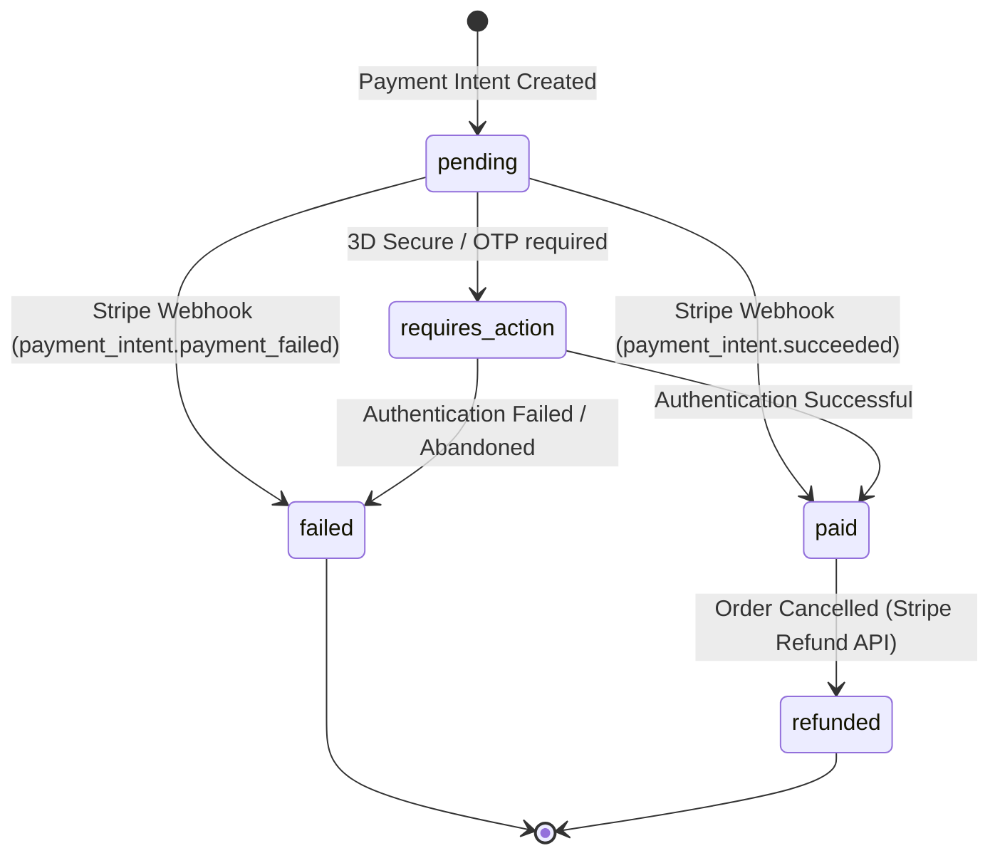

---

### 7.3 Inventory Reservation & Release Flow

To prevent **Overselling** under high concurrent purchase volume, Nexora implements an atomic conditional reservation strategy:

```mermaid
flowchart TD
    Start[Checkout Initiated] --> StartTx[Start MongoDB Transaction]
    StartTx --> CheckStock{Product.updateOne<br/>stock >= qty?}

    CheckStock -- Yes --> DecrStock[Atomically Decrement Stock<br/>$inc: { stock: -qty }]
    DecrStock --> CreateOrder[Create Order Record<br/>stockReserved = true]
    CreateOrder --> CommitTx[Commit Transaction]
    CommitTx --> Success[Proceed to Payment]

    CheckStock -- No (Modified == 0) --> AbortTx[Abort Transaction]
    AbortTx --> FailErr[Return 400 Insufficient Stock]

    Success --> OrderOutcome{Order Outcome}
    OrderOutcome -- Succeeded --> KeepStock[Stock Remains Deducted]
    OrderOutcome -- Cancelled / Expired --> ReleaseTx[Start Compensating Transaction]
    ReleaseTx --> IncrStock[Restore Stock<br/>$inc: { stock: +qty }]
    IncrStock --> UpdateOrder[Set stockReserved = false]
    UpdateOrder --> Done[Stock Restored to Pool]
```

---

## 8. Design Patterns & Engineering Highlights

| Pattern | Implementation in Nexora | Purpose & Architectural Benefit |
| :--- | :--- | :--- |
| **Polyglot Persistence** | MySQL for Auth + MongoDB for Catalog/Orders | Leverages the optimal storage engine for each bounded context. |
| **Service Layer Pattern** | `order.service.js` | Decouples complex multi-step checkout logic from HTTP controllers. |
| **Data Access Object (DAO)** | `User` object in `user.model.js` | Encapsulates parameterized SQL queries away from business logic. |
| **Idempotent Consumer** | `ProcessedEvent` model in webhook pipeline | Guarantees at-most-once processing of asynchronous webhook notifications. |
| **Client Idempotency Key** | `checkoutAttemptId` (UUID) | Prevents duplicate order placement during network timeouts or browser retries. |
| **Compensating Transaction** | Stock restoration in `cancelOrder` | Reverses inventory reservation upon terminal order failure or customer cancellation. |
| **Data Snapshotting** | Price & Title duplication in `orderSchema.items` | Protects historic financial audit logs against catalog price modifications. |
| **Guard Clauses & Early Exits** | Parameter and session checks in all services | Minimizes nested code complexity and enforces fail-fast error handling. |
