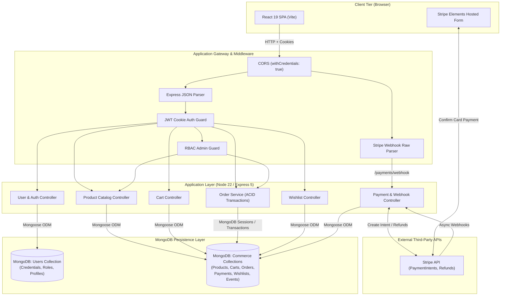
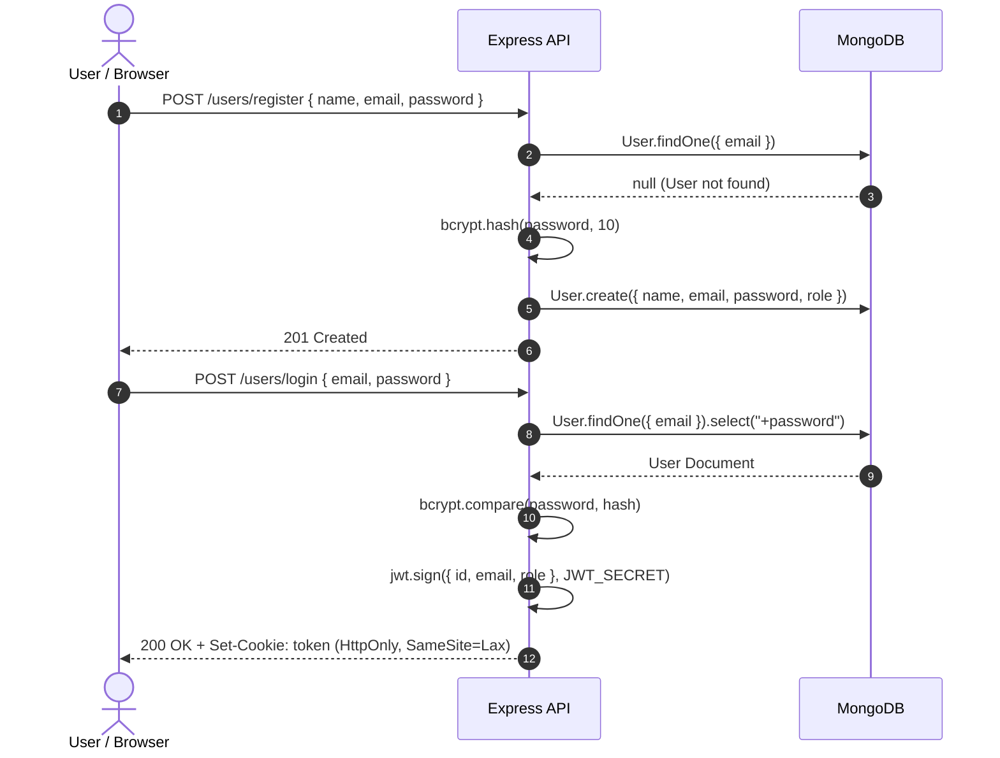
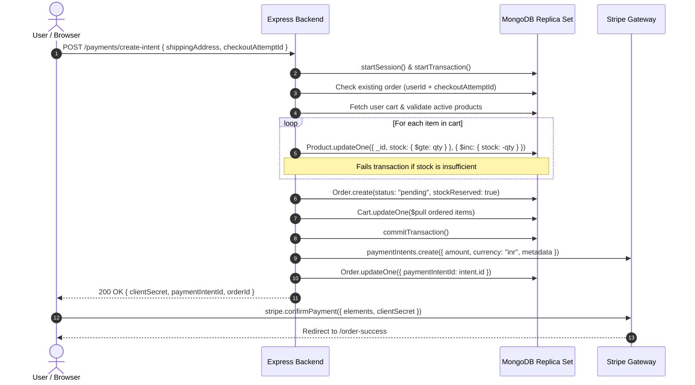
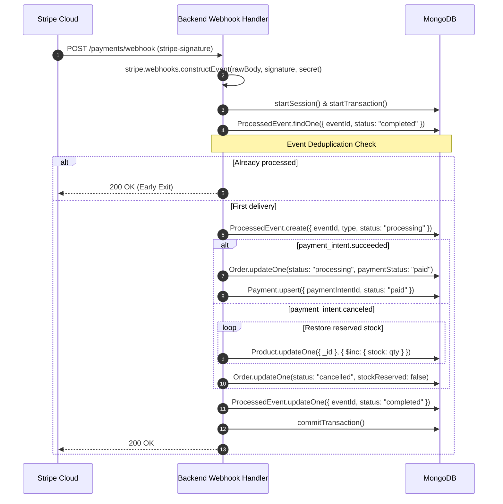
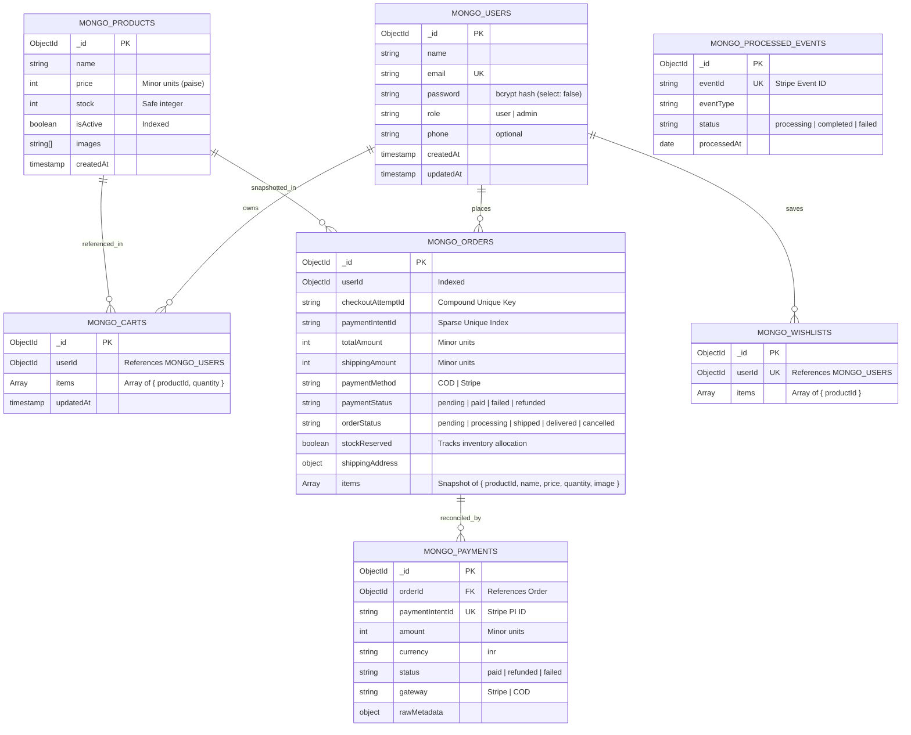

# 🛍️ Nexora — Enterprise E-Commerce Platform

[](https://nodejs.org/)
[](https://expressjs.com/)
[](https://react.dev/)
[](https://vitejs.dev/)\
[](https://www.mongodb.com/)
[](https://stripe.com/)
[](LICENSE)

Nexora is a full-stack, enterprise-grade e-commerce application built on a **unified MongoDB** data layer, managing all application entities — users, products, carts, orders, payments, and wishlists — within a single, scalable document store. Designed for real-world resilience, Nexora features **ACID-compliant distributed order placement**, **atomic inventory reservation**, **Stripe Payment Intent integrations with idempotency deduplication**, and a modern, responsive **React 19 SPA**.

---

## 📑 Table of Contents

- [Project Overview](#-project-overview)
- [Key Features](#-key-features)
- [Tech Stack](#-tech-stack)
- [System Architecture](#-system-architecture)
- [High-Level Data Flow](#-high-level-data-flow)
- [Repository Structure](#-repository-structure)
- [Database Architecture](#-database-architecture)
- [Getting Started](#-getting-started)
  - [Prerequisites](#prerequisites)
  - [Installation](#installation)
  - [Environment Variables](#environment-variables)
  - [Running Locally](#running-locally)
  - [Docker Setup](#docker-setup)
- [API Overview](#-api-overview)
- [Security Architecture](#-security-architecture)
- [Performance & Scalability](#-performance--scalability)
- [Testing Strategy](#-testing-strategy)
- [Known Issues & Code Smells](#-known-issues--code-smells)
- [Roadmap & Enhancements](#-roadmap--enhancements)
- [Contributing](#-contributing)
- [License](#-license)
- [Supplementary Documentation](#-supplementary-documentation)

---

## 🌟 Project Overview

Modern e-commerce platforms require a database that balances flexible schema design with strong transactional guarantees. Nexora solves this by consolidating all application data into a **single MongoDB** instance:

1. **Unified Document Store (MongoDB)**: Manages user identities, authentication credentials, product catalogs, transient shopping carts, immutable order snapshots, Stripe payment event logs, and user wishlists.
2. **Resilient Transaction Engine**: Guarantees zero stock overselling by leveraging MongoDB multi-document transactions with conditional atomic decrement queries (`stock >= quantity`), coupled with a cryptographically enforced Stripe webhook idempotency engine.

---

## ✨ Key Features

### 🛒 Customer Experience
- **Interactive Catalog**: Paginated product catalog with category-based filtering, regex-based keyword search, and ASC/DESC multi-field sorting.
- **Dynamic Shopping Cart**: Real-time server-synchronized cart with automatic stale-product cleanup (purges deleted products upon cart fetch).
- **Dual Payment Channels**: Seamless checkout using **Stripe Elements** (Card, Net Banking, UPI, Wallets) or **Cash on Delivery (COD)**.
- **Idempotent Checkout**: Client-side UUID generation (`checkoutAttemptId`) ensuring network retries never double-charge or create duplicate orders.
- **Self-Service Order Management**: Track real-time order progression (`pending` → `processing` → `shipped` → `delivered`) with automated stock restoration upon cancellation.
- **Customer Wishlist**: Persistent product bookmarking with instant add/remove toggling.
- **User Profile Management**: Authenticated profile viewing and contact detail updates.

### 🛡️ Administrative Portal
- **Catalog Management**: Create, update, soft-activate, and deactivate inventory with validation guards.
- **Order Pipeline Control**: Enforce state transition rules (e.g., `pending` → `processing` → `shipped` → `delivered`, preventing illegal state skips).
- **Inventory Oversight**: Real-time stock visibility and management.

### ⚙️ Engineering & Distributed Systems Highlights
- **Stripe Webhook Idempotency**: `ProcessedEvent` collection enforces single-execution semantics for out-of-order and duplicate webhook events.
- **Atomic Concurrency Protection**: Inventory stock is reserved inside an active database transaction; failed charges or cancellations automatically trigger compensating stock replenishments.
- **Price & Metadata Snapshotting**: Orders store exact product price snapshots at time-of-purchase, isolating historic records from future catalog price edits.
- **Stateless Session Security**: JWT authentication packaged in HTTP-Only, SameSite cookies to mitigate XSS and token exfiltration attacks.

---

## 🛠️ Tech Stack

### Frontend
| Technology | Version | Purpose |
| :--- | :--- | :--- |
| [React](https://react.dev/) | `19.2.8` | Component-based UI library |
| [Vite](https://vitejs.dev/) | `8.2.0` | Ultra-fast build tool and dev server |
| [React Router](https://reactrouter.com/) | `7.18.2` | Client-side routing and protected route guards |
| [@stripe/react-stripe-js](https://stripe.com/docs/stripe-js/react) | `6.9.0` | Secure Stripe Elements payment UI components |
| [@stripe/stripe-js](https://stripe.com/docs/js) | `9.15.0` | Stripe client-side SDK loader |
| [Axios](https://axios-http.com/) | `1.19.0` | Promise-based HTTP client configured with credentials |
| [CSS3](https://developer.mozilla.org/en-US/docs/Web/CSS) | Native | Modular, scoped BEM-like styling system |

### Backend
| Technology | Version | Purpose |
| :--- | :--- | :--- |
| [Node.js](https://nodejs.org/) | `22.x` | Modern JavaScript runtime (ES Modules native) |
| [Express.js](https://expressjs.com/) | `5.2.1` | Next-generation minimalist web framework |
| [Mongoose](https://mongoosejs.com/) | `9.9.3` | Object Data Modeling (ODM) for MongoDB |
| [Stripe SDK](https://github.com/stripe/stripe-node) | `22.3.0` | Server-side Stripe API client |
| [JSON Web Token (JWT)](https://jwt.io/) | `9.0.3` | Cryptographic session tokens |
| [Bcrypt](https://github.com/kelektiv/node.bcrypt.js) | `6.0.0` | Salted password hashing (cost factor 10) |
| [Cookie-Parser](https://github.com/expressjs/cookie-parser) | `1.4.7` | HTTP request cookie deserialization middleware |
| [CORS](https://github.com/expressjs/cors) | `2.8.6` | Cross-Origin Resource Sharing control |
| [Dotenv](https://github.com/motdotla/dotenv) | `17.4.2` | Runtime environment configuration loader |

### Infrastructure & Databases
| Technology | Role |
| :--- | :--- |
| **MongoDB 7.0+** | Unified store for users, catalogs, orders, carts, wishlists, and webhook idempotency events |
| **Docker & Docker Compose** | Containerized local environment orchestrating Node.js and MongoDB |

---

## 🏛️ System Architecture



---

## 🔄 High-Level Data Flow

### 1. User Registration & Authentication


### 2. ACID-Compliant Checkout & Inventory Reservation Flow


### 3. Stripe Asynchronous Webhook Processing


---

## 📂 Repository Structure

```
E_commerce_app/
├── compose.yml                     # Docker Compose multi-service specification
├── package.json                    # Workspace meta descriptor
├── README.md                       # Comprehensive project handbook
├── ARCHITECTURE.md                 # Deep-dive system architecture specification
├── SYSTEM_DESIGN.md                # Principal-level system design analysis
├── API_REFERENCE.md                # REST API documentation & contract schemas
├── DEPLOYMENT.md                   # Production deployment & containerization guide
│
├── backend/                        # Node.js + Express 5 Backend Microservice
│   ├── Dockerfile                  # Container build instructions for backend
│   ├── index.js                    # Bootstrap entrypoint (dotenv initialisation)
│   ├── server.js                   # Express application setup, middlewares & routes
│   ├── package.json                # Backend dependencies and scripts
│   │
│   ├── config/                     # Database & integration clients
│   │   ├── mongo.js                # Mongoose connection manager
│   │   └── stripe.js               # Stripe API client instance
│   │
│   ├── controllers/                # Request validation and business orchestration
│   │   ├── cart.controller.js      # Cart CRUD and stock checking
│   │   ├── order.controller.js     # COD placement, cancellation & admin order management
│   │   ├── payment.controller.js   # Stripe PaymentIntents & idempotent webhook handler
│   │   ├── product.controller.js   # Catalog queries, search, pagination, and admin mutations
│   │   ├── user.controller.js      # Registration, auth, JWT issuance, profile updates
│   │   └── wishlist.controller.js  # Wishlist addition, listing, deletion
│   │
│   ├── middlewares/                # Custom express route interceptors
│   │   ├── auth.middleware.js      # Cookie JWT verification & req.user injection
│   │   └── admin.middleware.js     # Role-based access enforcement (role === 'admin')
│   │
│   ├── models/                     # MongoDB Mongoose Schema Layer
│   │   └── mongo/                  # Mongoose Schemas
│   │       ├── user.model.js       # User identity, credentials & roles
│   │       ├── cart.mongo.js       # User Cart model
│   │       ├── order.model.js      # Order model with compound unique indexes
│   │       ├── payment.model.js    # Payment transaction ledger
│   │       ├── processedEvent.model.js # Webhook idempotency event store
│   │       ├── product.model.js    # Product catalog schema
│   │       └── wishlist.model.js   # User wishlist schema
│   │
│   ├── routes/                     # Express Router definitions
│   │   ├── admin.routes.js         # Protected administrative order routes
│   │   ├── cart.routes.js          # Cart manipulation endpoints
│   │   ├── getprofile.routes.js    # Authenticated user profile routes
│   │   ├── login.routes.js         # Authentication session initiation
│   │   ├── logout.routes.js        # Session revocation (cookie clearance)
│   │   ├── order.routes.js         # Customer order management endpoints
│   │   ├── payment.routes.js       # Stripe PaymentIntent creation
│   │   ├── products.routes.js      # Public & admin product catalog endpoints
│   │   ├── user.routes.js          # User registration route
│   │   └── wishlist.routes.js      # Customer wishlist endpoints
│   │
│   ├── services/                   # Encapsulated reusable domain logic
│   │   └── order.service.js        # Transactional cart-to-order pipeline & inventory locks
│   │
│   └── utils/                      # Helper utilities
│       ├── searchHelper.js         # Regex query sanitizer for product search
│       └── validateShippingAddress.js # Strict address schema & regex validator
│
└── frontend/                       # React 19 + Vite Frontend SPA
    ├── index.html                  # HTML5 application root shell
    ├── vite.config.js              # Vite bundler configuration
    ├── package.json                # Frontend dependencies and dev scripts
    │
    └── src/                        # React Application Source
        ├── main.jsx                # Application DOM mounting
        ├── App.jsx                 # Top-level application wrapper
        │
        ├── assets/                 # Static brand assets & category images
        ├── components/             # Reusable presentation components
        │   ├── Navbar.jsx          # Dynamic global navigation & user dropdown
        │   ├── ProductCard.jsx     # Card component for catalog display
        │   ├── OrderCard.jsx       # Order presentation card with cancellation toggle
        │   └── home/               # Homepage domain components (Hero, Featured, etc.)
        │
        ├── context/                # Global React State Providers
        │   ├── AuthContext.jsx     # Authentication lifecycle & session state
        │   └── CartContext.jsx     # Cart operations, quantity mutations, and subtotal
        │
        ├── pages/                  # Routed application views
        │   ├── Home.jsx            # Landing page with hero banner & sections
        │   ├── Login.jsx           # Customer & admin authentication
        │   ├── Register.jsx        # Account registration
        │   ├── Products.jsx        # Filterable & searchable product directory
        │   ├── ProductDetails.jsx  # Gallery view, inventory status, and add-to-cart
        │   ├── Cart.jsx            # Line-item review & quantity modifiers
        │   ├── Checkout.jsx        # Multi-field address validation & payment selection
        │   ├── Payment.jsx         # Stripe Elements container
        │   ├── PaymentForm.jsx     # Stripe PaymentElement submission handler
        │   ├── OrderSuccess.jsx    # Post-checkout confirmation
        │   ├── OrderHistory.jsx    # Customer order audit log
        │   ├── OrderDetails.jsx    # Deep order inspect & cancellation view
        │   ├── Wishlist.jsx        # Saved products view
        │   ├── Profile.jsx         # Contact information editor
        │   └── admin/              # Administrative Management Pages
        │       ├── AddProduct.jsx  # Product catalog creation form
        │       ├── AdminOrders.jsx # State-machine transition control panel
        │       ├── AdminProducts.jsx # Inventory toggling and edit access
        │       └── EditProduct.jsx # Catalog detail editor
        │
        ├── routes/                 # Navigation Guards & Routing tree
        │   ├── AppRoutes.jsx       # Route declarations
        │   └── ProtectedRoute.jsx  # Authentication gatekeeper
        │
        ├── services/               # API Clients
        │   └── api.js              # Axios instance configured with baseURL & cookies
        │
        └── styles/                 # Modular CSS stylesheets
```

---

## 🗄️ Database Architecture

Nexora's unified MongoDB schema stores all entities in a single database. User ObjectIds act as the foreign key linking users to their carts, orders, and wishlists:



---

## 🚀 Getting Started

### Prerequisites
- **Node.js**: `v20.x` or `v22.x LTS`
- **npm**: `v10.x+`
- **MongoDB**: `v6.0+` or `v7.0+` replica set (transactions require replica sets)
- **Stripe Account**: API test keys (`pk_test_...` and `sk_test_...`)

---

### Installation

1. **Clone the repository**:
   ```bash
   git clone https://github.com/your-username/nexora-ecommerce.git
   cd nexora-ecommerce
   ```

2. **Install Backend Dependencies**:
   ```bash
   cd backend
   npm install
   ```

3. **Install Frontend Dependencies**:
   ```bash
   cd ../frontend
   npm install
   ```

---

### Environment Variables

#### Backend Configuration (`backend/.env`)
Create a `.env` file in the `backend/` directory:

```env
# Server Configuration
PORT=3000
NODE_ENV=development

# MongoDB Database (Must support Replica Sets for Transactions)
MONGO_URI=mongodb://localhost:27017/e_commerce?replicaSet=rs0

# JWT Authentication
JWT_SECRET=your_super_secret_jwt_key_change_in_production

# Stripe Payments
STRIPE_SECRET_KEY=sk_test_REPLACE_WITH_YOUR_KEY
STRIPE_WEBHOOK_SECRET=whsec_REPLACE_WITH_YOUR_KEY
```

#### Frontend Configuration (`frontend/.env`)
Create a `.env` file in the `frontend/` directory:

```env
# Stripe Client Publishable Key
VITE_STRIPE_PUBLISHABLE_KEY=pk_test_REPLACE_WITH_YOUR_KEY
```

---

### Running Locally

1. **Start the Backend API Server**:
   ```bash
   cd backend
   npm start
   # Or with auto-reload:
   npx nodemon index.js
   ```
   *The server runs at: `http://localhost:3000`*

2. **Start the Frontend Vite Dev Server**:
   ```bash
   cd ../frontend
   npm run dev
   ```
   *The application opens at: `http://localhost:5173`*

3. **Forward Stripe Webhooks (Optional for local testing)**:
   Install the [Stripe CLI](https://stripe.com/docs/stripe-cli) and run:
   ```bash
   stripe listen --forward-to localhost:3000/payments/webhook
   ```
   Copy the printed signing secret into `STRIPE_WEBHOOK_SECRET` in `backend/.env`.

---

### Docker Setup

The project includes container specifications via `compose.yml`:

```bash
docker compose up -d mongodb
```

*Note: For detailed Docker production instructions, multi-stage containerization, and networking setup, refer to [DEPLOYMENT.md](DEPLOYMENT.md).*

---

## 📡 API Overview

| Area | Method | Endpoint | Access | Purpose |
| :--- | :--- | :--- | :--- | :--- |
| **Auth** | `POST` | `/users/register` | Public | Register new customer account |
| **Auth** | `POST` | `/users/login` | Public | Authenticate user & issue HTTP-Only JWT cookie |
| **Auth** | `POST` | `/users/logout` | Authenticated | Clear session cookie |
| **Profile** | `GET` | `/users/profile` | Authenticated | Retrieve current user profile |
| **Profile** | `PUT` | `/users/profile` | Authenticated | Update user name and phone |
| **Products** | `GET` | `/product` | Public | Paginated product search, category filtering & sorting |
| **Products** | `GET` | `/product/categories` | Public | List all distinct product categories |
| **Products** | `GET` | `/product/:id` | Public | Fetch product detail by ID |
| **Admin** | `POST` | `/product` | Admin | Create product in catalog |
| **Admin** | `PUT` | `/product/:id` | Admin | Update product details or toggle `isActive` |
| **Admin** | `DELETE`| `/product/:id` | Admin | Remove product from catalog |
| **Admin** | `GET` | `/product/admin/all` | Admin | Fetch all products including deactivated items |
| **Cart** | `GET` | `/cart` | Authenticated | Retrieve active cart with populated product data |
| **Cart** | `POST` | `/cart` | Authenticated | Add item to cart or increment quantity |
| **Cart** | `PUT` | `/cart/:productId` | Authenticated | Update cart item quantity |
| **Cart** | `DELETE`| `/cart/:productId`| Authenticated | Remove product from cart |
| **Orders** | `POST` | `/order` | Authenticated | Place Cash-On-Delivery (COD) order |
| **Orders** | `GET` | `/order` | Authenticated | List all customer orders |
| **Orders** | `GET` | `/order/:orderId` | Authenticated | Retrieve customer order detail (ownership guarded) |
| **Orders** | `PUT` | `/order/cancel/:orderId` | Authenticated | Cancel order, refund Stripe charge, restore stock |
| **Admin** | `GET` | `/admin/order` | Admin | List all orders across all users |
| **Admin** | `PUT` | `/admin/order/:orderId`| Admin | Enforce order status transition (`processing`, `shipped`) |
| **Payments**| `POST` | `/payments/create-intent`| Authenticated | Reserve inventory & create Stripe PaymentIntent |
| **Payments**| `POST` | `/payments/webhook` | Stripe Only | Webhook receiver with cryptographic signature validation |
| **Wishlist**| `GET` | `/wishlist` | Authenticated | Retrieve saved products |
| **Wishlist**| `POST` | `/wishlist/:productId` | Authenticated | Add product to wishlist |
| **Wishlist**| `DELETE`| `/wishlist/:productId`| Authenticated | Remove product from wishlist |

*For complete payload contracts, validation constraints, and cURL examples, see [API_REFERENCE.md](API_REFERENCE.md).*

---

## 🔒 Security Architecture

1. **HttpOnly Cookie Authentication**:
   JWT tokens are stored inside `httpOnly`, `sameSite: "lax"` cookies, protecting tokens from malicious client-side script exfiltration (`document.cookie` is blind to the token).
2. **NoSQL Injection Defense**:
   All database queries use Mongoose's typed schema layer and parameterized query builders, completely neutralizing NoSQL injection vectors.
3. **Webhook Signature Cryptography**:
   Stripe webhooks are intercepted as raw byte buffers (`express.raw({ type: "application/json" })`) before JSON parsing, allowing `stripe.webhooks.constructEvent()` to cryptographically verify HMAC signatures.
4. **Idempotent Webhook Consumer**:
   A dedicated `ProcessedEvent` collection enforces single-execution semantics. Even if Stripe sends duplicate webhook events, identical events exit without side effects.
5. **Ownership Guards on Resources**:
   Endpoints querying sensitive customer records (e.g., `GET /order/:orderId`, `PUT /order/cancel/:orderId`, `GET /cart`) filter by `userId: req.user.id`, preventing Insecure Direct Object Reference (IDOR) attacks.

---

## ⚡ Performance & Scalability

- **Compound Indexing**:
  MongoDB order queries leverage compound indexes `{ userId: 1, checkoutAttemptId: 1 }` and sparse unique indexes `{ paymentIntentId: 1 }` for near-instant $O(1)$ lookups.
- **MongoDB Connection Pooling**:
  Mongoose manages a built-in connection pool via `mongoose.connect()`, reusing connections across requests and preventing connection thrashing under high load.
- **Lazy Image Loading**:
  Product thumbnails and gallery views utilize native browser `loading="lazy"` attributes, minimizing initial page load weight.
- **Client-Side Debouncing & Memoization**:
  Frontend cart state utilizes React's `useCallback` to ensure stable references across rerenders and prevent redundant network calls.

---

## 🧪 Testing Strategy

1. **Unit Testing**:
   - Validation suites for `validateShippingAddress.js` (testing postal code and 10-digit phone patterns).
   - Password hashing and verification via Bcrypt.
2. **Integration Testing**:
   - Order placement pipeline inside MongoDB sessions.
   - Idempotent checkout attempt verification with duplicate `checkoutAttemptId` payloads.
3. **End-to-End (E2E) & Webhook Mocking**:
   - Stripe CLI webhook triggers (`stripe trigger payment_intent.succeeded`).
   - Order cancellation and inventory refund reconciliation tests.

---

## 🔍 Known Issues & Code Smells

During our comprehensive architecture review, the following discrepancies were identified in the codebase:

1. **Monetary Unit Mismatch**:
   - The backend defines prices in minor units (paise/cents), and `OrderDetails.jsx` divides by 100 (`amount / 100`).
   - However, `ProductCard.jsx`, `ProductDetails.jsx`, and `AddProduct.jsx` display prices directly in whole currency without transformation.
   - `Checkout.jsx` adds `shipping = 50`, while the backend defaults to `5000` paise.
2. **Product Schema Attribute Drift**:
   - `product.model.js` schema does not formally define `category`, `brand`, or `description`.
   - While `product.controller.js` and `AddProduct.jsx` operate on these fields, Mongoose strict mode may strip them unless relaxed.
3. **Frontend Logout Endpoint Mismatch**:
   - `AuthContext.jsx` executes `api.post("/logout")`, but `server.js` mounts the route at `/users/logout`.
4. **Frontend Admin Guard Missing**:
   - `ProtectedRoute.jsx` checks only if the user is authenticated, not if `user.role === 'admin'`, allowing regular users to view admin routes client-side (though the backend blocks operations with 403).
5. **Stripe Import Case Sensitivity**:
   - `backend/config/stripe.js` imports from `'Stripe'` (uppercase), which causes runtime resolution errors on Linux/Docker environments.

*For detailed code-level remediation steps, consult [SYSTEM_DESIGN.md](SYSTEM_DESIGN.md).*

---

## 🗺️ Roadmap & Enhancements

- [ ] **Unified Unit Handling**: Refactor frontend and backend to strictly enforce ISO minor currency units across all display and submission layers.
- [ ] **Redis Caching**: Integrate Redis to cache product catalog pages and category listings with automated cache eviction.
- [ ] **Role-Based Frontend Guards**: Implement an explicit `<AdminRoute />` wrapper in React Router.
- [ ] **Elasticsearch / Meilisearch**: Migrate search queries from MongoDB regex to a dedicated typo-tolerant search engine.
- [ ] **Automated CI/CD Pipeline**: GitHub Actions workflow for linting, testing, and automated Docker image deployment.

---

## 🤝 Contributing Guidelines

1. **Fork the Repository**: Create your feature branch (`git checkout -b feature/AmazingFeature`).
2. **Commit Your Changes**: Follow conventional commits (`git commit -m 'feat: add stripe refund verification'`).
3. **Push to the Branch**: (`git push origin feature/AmazingFeature`).
4. **Open a Pull Request**: Provide a detailed summary of your changes, referencing any open issues.

---

## 📄 License

This project is licensed under the **ISC License**. See the `LICENSE` file for details.

---

## 📚 Supplementary Documentation

To explore the architecture, APIs, and production deployment in greater detail:

- 🏛️ [**ARCHITECTURE.md**](ARCHITECTURE.md) — Comprehensive architectural patterns, component topology, and flow diagrams.
- 📐 [**SYSTEM_DESIGN.md**](SYSTEM_DESIGN.md) — Distributed transaction design, idempotency mechanics, concurrency control, and code smell analysis.
- 📖 [**API_REFERENCE.md**](API_REFERENCE.md) — Exhaustive REST API contract with schemas, validation rules, and cURL examples.
- 🚢 [**DEPLOYMENT.md**](DEPLOYMENT.md) — Multi-stage Docker builds, production Nginx configuration, and cloud deployment guides.
