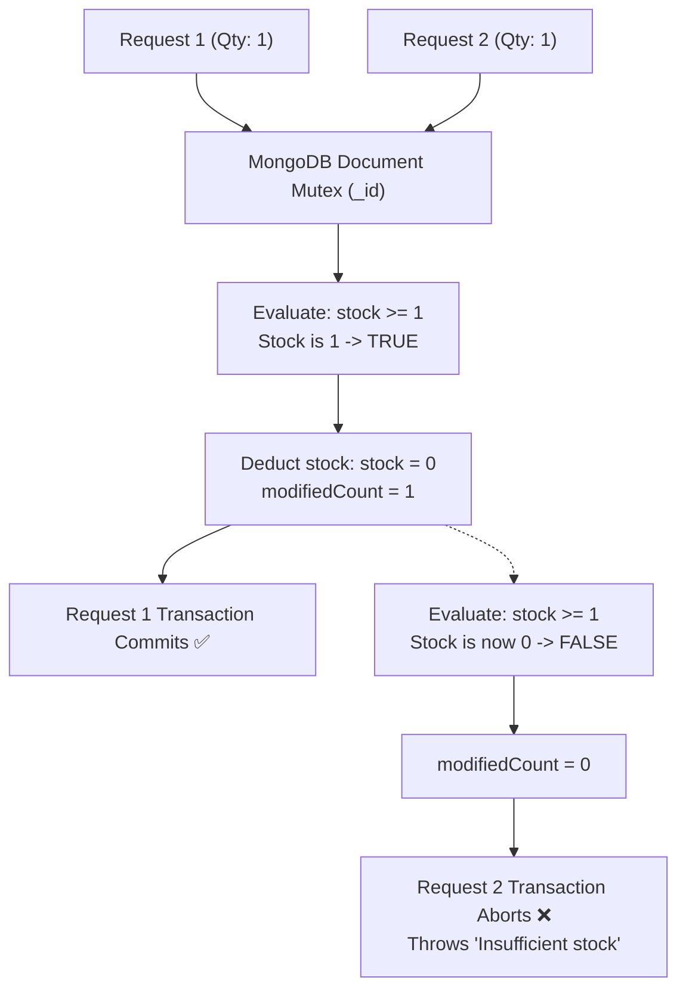
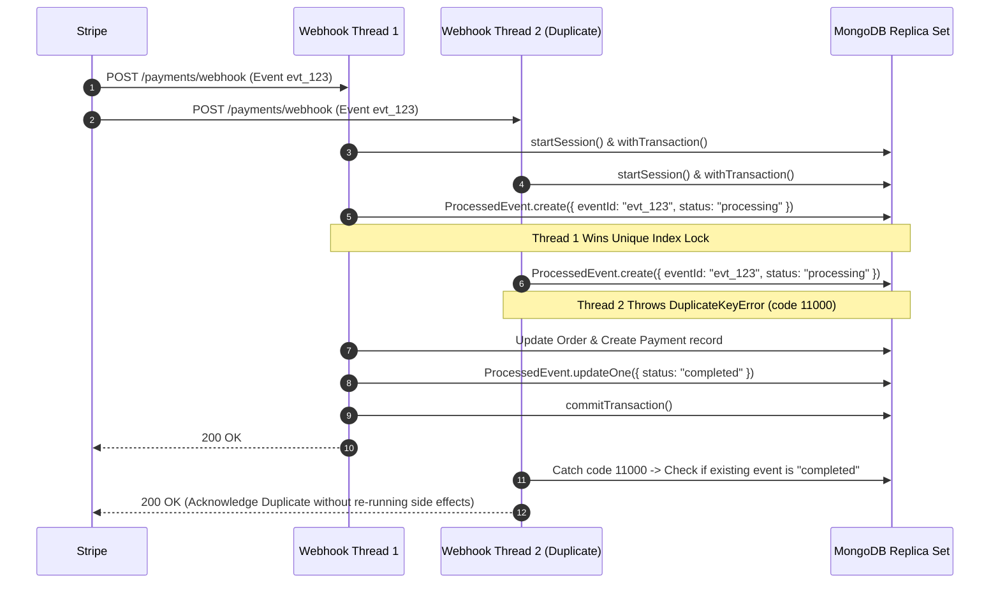
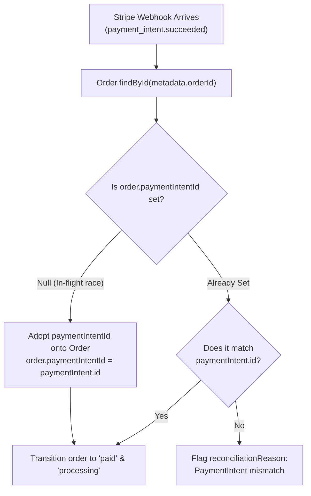
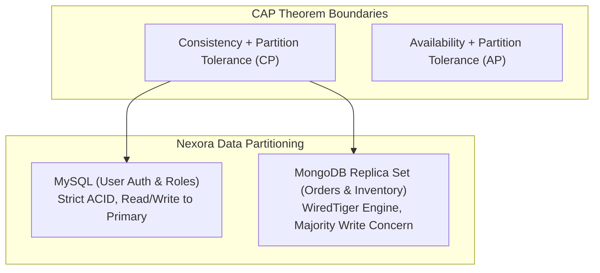
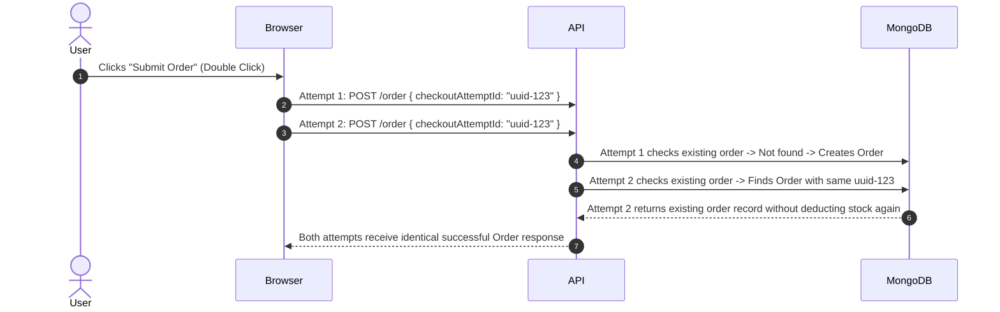
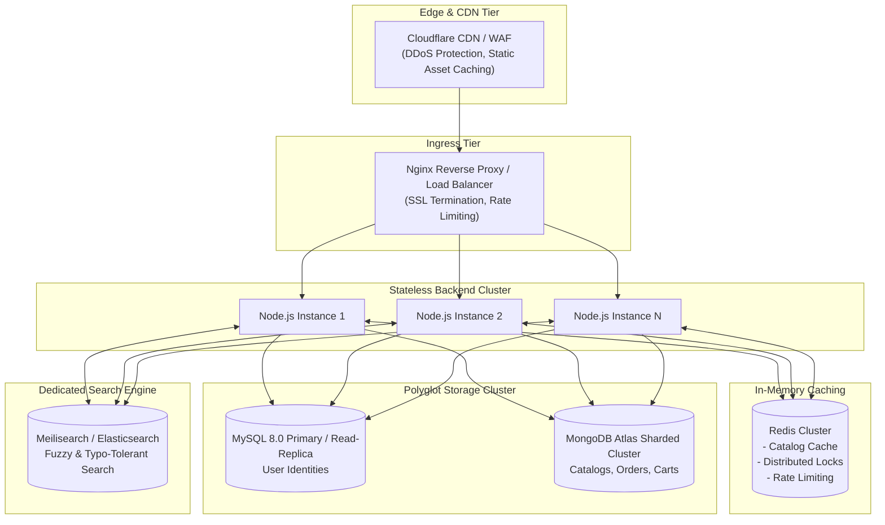

# 📐 Nexora System Design & Technical Specification

> **Audience**: Principal Engineers, System Architects, Technical Interviewers, and Lead Developers.  
> **Topic**: Distributed concurrency, ACID transaction models, payment idempotency, failure mode analysis, code smell identification, and horizontal scalability.

---

## 📑 Table of Contents

- [1. Executive Summary & Problem Space](#1-executive-summary--problem-space)
- [2. Concurrency Control & The Overselling Problem](#2-concurrency-control--the-overselling-problem)
  - [2.1 Race Condition Mechanics in Flash Sales](#21-race-condition-mechanics-in-flash-sales)
  - [2.2 Atomic Conditional Mutex in MongoDB](#22-atomic-conditional-mutex-in-mongodb)
  - [2.3 Comparison: DB-Level Atomic Writes vs. Redis Distributed Locks](#23-comparison-db-level-atomic-writes-vs-redis-distributed-locks)
- [3. Payment Reliability & Stripe Webhook Idempotency](#3-payment-reliability--stripe-webhook-idempotency)
  - [3.1 Webhook Delivery Pitfalls (At-Least-Once & Out-of-Order)](#31-webhook-delivery-pitfalls-at-least-once--out-of-order)
  - [3.2 The ProcessedEvent Deduplication Engine](#32-the-processedevent-deduplication-engine)
  - [3.3 Edge Case: Early Webhook vs. In-Flight Client Handshake](#33-edge-case-early-webhook-vs-in-flight-client-handshake)
  - [3.4 Financial Reconciliation & Tamper Detection](#34-financial-reconciliation--tamper-detection)
- [4. Polyglot Persistence & Data Consistency Models](#4-polyglot-persistence--data-consistency-models)
  - [4.1 CAP Theorem Positioning](#41-cap-theorem-positioning)
  - [4.2 The Dual-Write Problem & Boundary Decoupling](#42-the-dual-write-problem--boundary-decoupling)
- [5. End-to-End Idempotency Architecture](#5-end-to-end-idempotency-architecture)
  - [5.1 The `checkoutAttemptId` Invariant](#51-the-checkoutattemptid-invariant)
  - [5.2 Stripe Idempotency Key Propagation](#52-stripe-idempotency-key-propagation)
- [6. Failure Modes, Chaos Scenarios & Recovery](#6-failure-modes-chaos-scenarios--recovery)
- [7. Comprehensive Code Smell & Vulnerability Audit](#7-comprehensive-code-smell--vulnerability-audit)
  - [7.1 Currency Unit Representation Mismatch](#71-currency-unit-representation-mismatch)
  - [7.2 Schema Drift in Mongoose Models](#72-schema-drift-in-mongoose-models)
  - [7.3 Frontend API Route Mismatch (Silent Logout Failure)](#73-frontend-api-route-mismatch-silent-logout-failure)
  - [7.4 Missing Client-Side RBAC Guard](#74-missing-client-side-rbac-guard)
  - [7.5 Linux Case-Sensitive Module Resolution Bug](#75-linux-case-sensitive-module-resolution-bug)
  - [7.6 Security Credentials in Version Control](#76-security-credentials-in-version-control)
- [8. Production Scalability & Evolution Roadmap](#8-production-scalability--evolution-roadmap)

---

## 1. Executive Summary & Problem Space

E-commerce architectures face demanding correctness constraints:
1. **Financial Precision**: Under no circumstance may a customer be charged without a corresponding order, nor charged twice for the same intent.
2. **Inventory Integrity**: Stock counts must never dip below zero under high concurrent loads.
3. **High Availability vs. Consistency**: User registration and profile management prioritize ACID relational guarantees, while product browsing demands high read throughput and horizontal scaling.

Nexora addresses these challenges through a **hybrid relational/document system** incorporating **client-originated idempotency tokens**, **database transaction sessions**, and **cryptographic webhook validation**.

---

## 2. Concurrency Control & The Overselling Problem

### 2.1 Race Condition Mechanics in Flash Sales

In a naive implementation, checking and deducting inventory uses a "Read-Then-Write" pattern:

```javascript
// ❌ NAIVE IMPLEMENTATION (RACE CONDITION VULNERABLE)
const product = await Product.findById(productId);
if (product.stock >= requestedQuantity) {
  // If two requests reach this line concurrently, both observe available stock!
  await Product.findByIdAndUpdate(productId, {
    stock: product.stock - requestedQuantity
  });
}
```

If a product has `stock = 1`, and Customer A and Customer B both submit checkout orders within the same 5-millisecond window, both threads read `stock = 1`. Both proceed to decrement, resulting in `stock = -1` (Overselling).

---

### 2.2 Atomic Conditional Mutex in MongoDB

Nexora solves this by leveraging MongoDB's single-document atomic update guarantees within an active transaction session (`backend/services/order.service.js`):

```javascript
// ✅ ATOMIC CONDITIONAL MUTEX (NEXORA IMPLEMENTATION)
const stockUpdateResult = await Product.updateOne(
  {
    _id: item.productId,
    isActive: true,
    stock: { $gte: item.quantity }, // Predicate guard
  },
  {
    $inc: { stock: -item.quantity }, // Atomic decrement
  },
  { session } // Multi-document transaction session
);

if (stockUpdateResult.modifiedCount !== 1) {
  throw new Error(`Insufficient stock or item became unavailable: ${product.name}`);
}
```



#### Why This Works:
1. **Document-Level Write Lock**: MongoDB acquires an exclusive write lock on the specific product document for the duration of the mutation.
2. **Atomic Predicate Check**: The `{ stock: { $gte: item.quantity } }` criteria is evaluated atomically with the `$inc` update.
3. **Zero Phantom Reads**: Even under extreme concurrency (thousands of requests/sec), only requests that satisfy the predicate modify the document (`modifiedCount === 1`). All others fail cleanly without race conditions.

---

### 2.3 Comparison: DB-Level Atomic Writes vs. Redis Distributed Locks

| Metric | DB-Level Atomic Writes (Nexora's Choice) | Redis Distributed Locks (Redlock) |
| :--- | :--- | :--- |
| **Complexity** | Low — Relies on native database engine primitives. | High — Requires standalone Redis cluster, TTL management, clock drift compensation. |
| **Deadlock Risk** | Zero — Handled by standard DB timeout/abort mechanisms. | Moderate — Unreleased locks, network partitions causing premature lease expiry. |
| **Network Hops** | 1 hop (direct to DB). | 2–3 hops (Acquire lock in Redis -> Query DB -> Release lock). |
| **Failure Recovery** | Automatic rollback via `session.abortTransaction()`. | Requires explicit lock release scripts in `finally` blocks. |
| **Throughput** | High for single-document contention; scaled via replica sets. | Extremely high for distributed multi-datacenter locks. |

**Verdict**: For small to mid-scale e-commerce, DB-level atomic conditional updates combined with database transactions provide maximum reliability with the lowest operational overhead.

---

## 3. Payment Reliability & Stripe Webhook Idempotency

### 3.1 Webhook Delivery Pitfalls (At-Least-Once & Out-of-Order)

Stripe webhooks are delivered with **at-least-once delivery guarantees**:
1. **Network Retries**: If Nexora takes longer than Stripe's timeout to return HTTP 200, Stripe retries the same event multiple times.
2. **Out-of-Order Delivery**: Stripe may deliver `payment_intent.succeeded` before the user's browser has even received the response from `/payments/create-intent`.
3. **Concurrent Delivery**: Stripe can deliver the exact same event concurrently on separate worker threads.

---

### 3.2 The ProcessedEvent Deduplication Engine

Nexora defends against duplicates using a dedicated collection (`ProcessedEvent`) configured with an enforced DB-level unique constraint:

```javascript
// models/mongo/processedEvent.model.js
processedEventSchema.index({ eventId: 1 }, { unique: true });
```

During webhook execution (`backend/controllers/payment.controller.js`):



---

### 3.3 Edge Case: Early Webhook vs. In-Flight Client Handshake

A common distributed systems pitfall occurs when Stripe fires `payment_intent.succeeded` before the API server completes associating `paymentIntentId` with the `Order` record:



Nexora explicitly handles this race in `payment.controller.js` (lines 354–363):
```javascript
// A success event may arrive before the initialization request
// has saved the PaymentIntent ID. Associate it if still unassigned.
order.paymentIntentId = paymentIntent.id;
order.paymentStatus = "paid";
order.orderStatus = "processing";
order.reconciliationReason = null;
await order.save({ session });
```

---

### 3.4 Financial Reconciliation & Tamper Detection

To protect against client-side price tampering or corrupted Stripe requests, the webhook handler validates three core invariants before transitioning payment state:

```javascript
const amountMatches = paymentIntent.amount === order.totalAmount;
const currencyMatches = paymentIntent.currency?.toLowerCase() === "inr";
const metadataMatches = 
  metadata.userId === order.userId.toString() &&
  metadata.checkoutAttemptId === order.checkoutAttemptId;

if (!amountMatches || !currencyMatches || !metadataMatches) {
  order.reconciliationReason = "Stripe payment amount/currency/metadata mismatch";
  await order.save({ session });
  // Money was collected by Stripe, but order is NOT fulfilled!
  // Requires manual admin reconciliation.
}
```

---

## 4. Polyglot Persistence & Data Consistency Models

### 4.1 CAP Theorem Positioning



Nexora operates primarily as a **CP (Consistent and Partition Tolerant)** system for critical transactions:
- **Zero Overselling**: Sacrifices write availability during database partition rather than allowing negative inventory or double payments.
- **WiredTiger Majority Commits**: MongoDB multi-document transactions ensure data is written to a quorum of replica set nodes before acknowledging completion.

---

### 4.2 The Dual-Write Problem & Boundary Decoupling

A frequent architectural anti-pattern in polyglot systems is attempting a distributed two-phase commit (2PC) across heterogeneous databases (MySQL + MongoDB).

#### How Nexora Avoids Distributed 2PC:
Nexora **never modifies both MySQL and MongoDB in the same request transaction**. The domain boundaries are strictly orthogonal:
- **Registration / Login / Profile Updates**: Exclusively reads/writes to **MySQL**.
- **Cart / Product / Order / Payment**: Exclusively reads/writes to **MongoDB**, treating MySQL `userId` strictly as an uninterpreted numeric external key.

---

## 5. End-to-End Idempotency Architecture

### 5.1 The `checkoutAttemptId` Invariant

Every checkout initiation generates a cryptographically random UUID on the client (`crypto.randomUUID()`).

In MongoDB, this is enforced by a **compound unique index**:
```javascript
orderSchema.index({ userId: 1, checkoutAttemptId: 1 }, { unique: true });
```



---

### 5.2 Stripe Idempotency Key Propagation

When initializing the payment intent with Stripe, Nexora passes an idempotency key derived from the attempt:

```javascript
const paymentIntent = await stripe.paymentIntents.create(
  {
    amount: order.totalAmount,
    currency: "inr",
    metadata: { orderId: order._id.toString(), userId: userId.toString(), checkoutAttemptId },
  },
  {
    idempotencyKey: `pi_${userId}_${checkoutAttemptId}`,
  }
);
```

If network lag causes the Express backend to retry creating the intent, Stripe identifies the identical idempotency key and returns the original `PaymentIntent` rather than creating a second charge.

---

## 6. Failure Modes, Chaos Scenarios & Recovery

| Chaos Scenario | System Impact | Mitigation / Recovery Mechanism |
| :--- | :--- | :--- |
| **Server crashes mid-checkout** | MongoDB transaction in-flight. | MongoDB automatically aborts uncommitted transactions; reserved stock is never deducted; client retries safely with the same `checkoutAttemptId`. |
| **Stripe API outage during intent creation** | Order created in DB (`pending`), but intent creation fails. | API returns HTTP 500; stock remains reserved. User can retry checkout with the same `checkoutAttemptId` to pick up the existing order. |
| **Customer abandons cart at Stripe Payment page** | Order remains in `pending`, stock remains reserved. | **Recommended Enhancement**: Scheduled cron job / TTL index that cancels orders whose `createdAt` is older than 30 minutes and restores inventory. |
| **Stripe delivers duplicate `payment_intent.succeeded`** | Risk of fulfilling order twice or creating duplicate payment audit logs. | `ProcessedEvent.create()` enforces unique `eventId`. The second delivery detects existing event and returns HTTP 200 without side effects. |
| **Customer cancels order after Stripe payment** | Order marked `cancelled`; inventory must be refunded. | `cancelOrder` controller initiates an atomic session: restores product stock via `$inc: { stock: item.quantity }`, calls `stripe.refunds.create()`, and updates payment status to `refunded`. |

---

## 7. Comprehensive Code Smell & Vulnerability Audit

As part of this architectural review, we identified the following critical technical debt, security risks, and code smells:

### 7.1 Currency Unit Representation Mismatch
- **Severity**: High (Financial Calculation & UX Risk)
- **Finding**:
  - The backend (`order.model.js`, `order.service.js`, `payment.controller.js`) treats all monetary values in **minor units (paise)**. E.g., `SHIPPING_COST_PAISE = 5000` (₹50.00).
  - `OrderDetails.jsx` and `OrderHistory.jsx` format amounts using `amount / 100`.
  - However, `ProductCard.jsx`, `ProductDetails.jsx`, and `AddProduct.jsx` display prices directly in whole currency without dividing by 100.
  - Furthermore, `Checkout.jsx` adds `shipping = 50` on the frontend, while the backend recalculates and adds `5000` paise.
- **Remediation**:
  Standardize on integer minor units everywhere. All catalog items should store price in minor units (e.g. ₹499 is stored as `49900`), and all frontend views should use a single unified `formatCurrency(paise)` helper that divides by 100.

---

### 7.2 Schema Drift in Mongoose Models
- **Severity**: Medium (Data Integrity & Silent Truncation)
- **Finding**:
  - `backend/models/mongo/product.model.js` defines only `name`, `price`, `stock`, `isActive`, `images`.
  - It does **not** declare `category`, `brand`, or `description`.
  - In `AddProduct.jsx` and `product.controller.js`, these fields are sent and queried. By default, Mongoose strict mode strips fields not defined in the schema, which can lead to dropped catalog attributes.
  - `searchHelper.js` constructs an `$or` query including `{ description: regex }`, which runs against an unindexed or stripped field.
- **Remediation**:
  Update `product.model.js` to formally define `category`, `brand`, and `description` with appropriate text indexes:
  ```javascript
  productSchema.add({
    category: { type: String, required: true, index: true },
    brand: { type: String, default: "" },
    description: { type: String, default: "" },
  });
  productSchema.index({ name: "text", description: "text" });
  ```

---

### 7.3 Frontend API Route Mismatch (Silent Logout Failure)
- **Severity**: Medium (Session Bug)
- **Finding**:
  - In `frontend/src/context/AuthContext.jsx`, line 28 calls: `await api.post("/logout");`
  - In `backend/server.js`, line 40 mounts the logout route under: `app.use("/users", logoutRoute);`
  - Therefore, the server expects `POST /users/logout`. Calling `/logout` triggers the Express 404 fallback handler. While the client locally clears `user` state, the server-side HTTP-Only cookie remains alive in the browser until expiry.
- **Remediation**:
  Update `AuthContext.jsx`:
  ```javascript
  // Change from:
  await api.post("/logout");
  // To:
  await api.post("/users/logout");
  ```

---

### 7.4 Missing Client-Side RBAC Guard
- **Severity**: Low (UX / Security in Depth)
- **Finding**:
  - In `frontend/src/routes/AppRoutes.jsx`, administrative views (`/admin/orders`, `/admin/products`, `/admin/products/add`) are protected using the standard `<ProtectedRoute>` component.
  - `ProtectedRoute.jsx` checks only if `user` is non-null. It does **not** inspect `user.role === 'admin'`.
  - While backend endpoints correctly reject unauthorized requests with HTTP 403, standard shoppers can navigate into the admin UI shell.
- **Remediation**:
  Introduce a dedicated `<AdminRoute>` wrapper that inspects `user?.role === 'admin'` and redirects unauthorized customers to the home page or a 403 view.

---

### 7.5 Linux Case-Sensitive Module Resolution Bug
- **Severity**: High in CI/CD & Production Containers
- **Finding**:
  - In `backend/config/stripe.js`, line 1 reads:
    `import Stripe from 'Stripe';` (capitalized 'S').
  - On Windows development environments, the NTFS filesystem is case-insensitive, so this succeeds.
  - On Linux host kernels and inside the standard Debian/Alpine Docker container (`FROM node:22`), the filesystem is strictly case-sensitive. The `stripe` npm package in `node_modules/stripe` fails resolution with `MODULE_NOT_FOUND`.
- **Remediation**:
  Change `import Stripe from 'Stripe';` to `import Stripe from 'stripe';`.

---

### 7.6 Security Credentials in Version Control
- **Severity**: Critical (Credential Exposure)
- **Finding**:
  - `backend/.env` is tracked or present with hardcoded database passwords, an unprofessional/vulgar `JWT_SECRET` string, and Stripe test API keys.
- **Remediation**:
  - Ensure `.env` is listed in `.gitignore`.
  - Provide a clean `.env.example` file.
  - Rotate exposed Stripe keys immediately.
  - Enforce high-entropy cryptographic secrets in production (e.g. `openssl rand -hex 64`).

---

## 8. Production Scalability & Evolution Roadmap



### Strategic Milestones:
1. **Redis Cache-Aside Layer**: Cache popular catalog queries (`GET /product`) and category distinct lists with 60-second TTLs, evicting keys upon admin catalog mutations.
2. **Dedicated Search Cluster**: Replace MongoDB `$regex` full-scan queries with Meilisearch or Elasticsearch for millisecond typo-tolerant full-text search.
3. **Inventory Reservation Lease Worker**: Deploy a lightweight background cron worker (e.g., BullMQ or Agenda) to auto-cancel abandoned checkouts older than 15 minutes, automatically releasing reserved stock.
4. **Asynchronous Notification Pipeline**: Decouple email confirmation dispatch (order placed, order shipped) via a message broker (RabbitMQ / AWS SQS) to guarantee snappy HTTP API responses.
